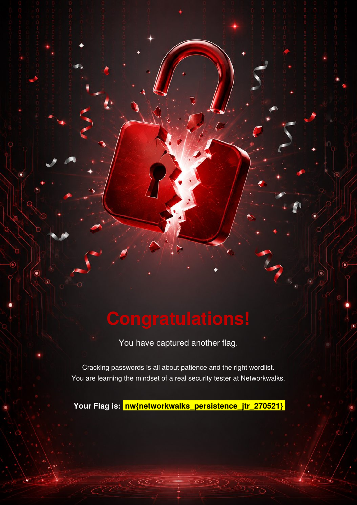
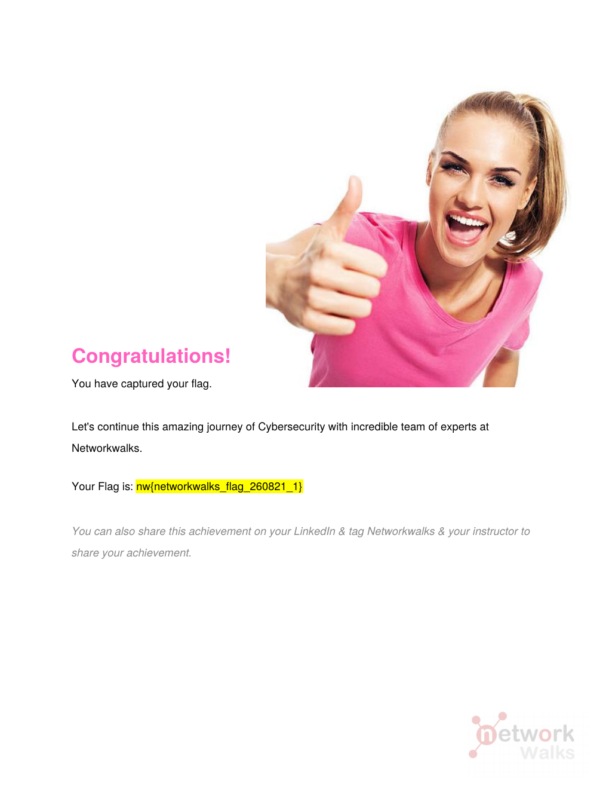

# Bonus — Extra locked PDFs (PDF2 & PDF3)

Two additional locked PDFs from the Week 3 pack, cracked with the exact same
`pdf2john` + dictionary-attack workflow as Module 1.

| File | Encryption | Password | Flag |
|------|-----------|----------|------|
| `My Locked PDF2.pdf` | AES/RC4 128-bit (R4/V4) | `password1` | `nw{networkwalks_persistence_jtr_270521}` |
| `My Locked PDF3.pdf` | AES/RC4 128-bit (R4/V4) | `1qaz2wsx` | `nw{networkwalks_flag_260821_1}` |

`1qaz2wsx` looks random but is a classic **keyboard-walk** password (first two
columns of the keyboard, top-to-bottom) — it appears in every real-world wordlist,
which is exactly why it cracked in seconds.

