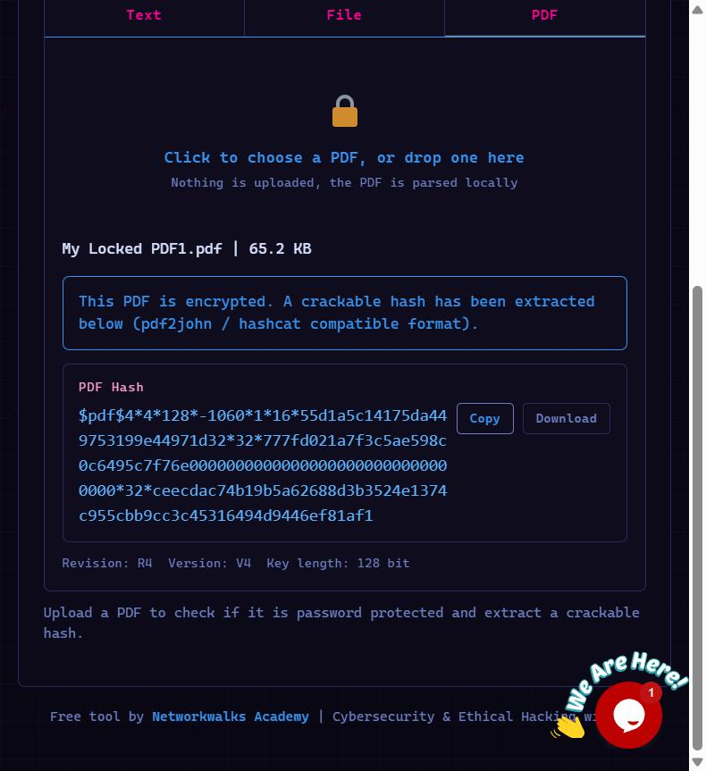
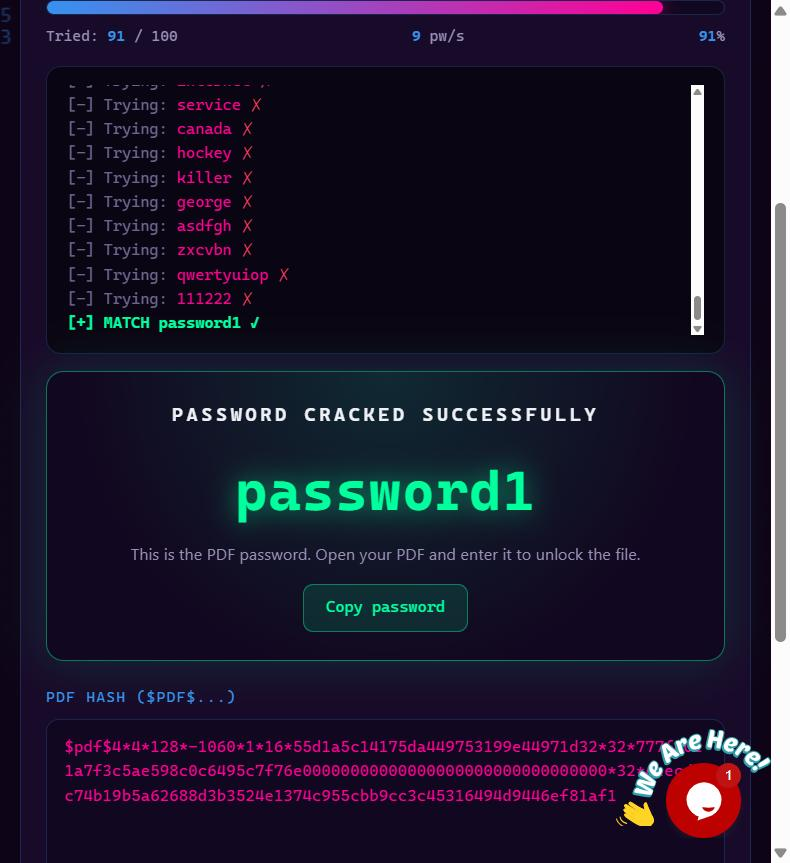

# W3-PM2 — Password Cracking with NetworkWalks Tools

**Task:** Crack `My Locked PDF1.pdf` using the NetworkWalks **Hash Calculator** and
**Password Cracker** (both run in the browser — nothing to install).

**Result:** password = **`password1`** → flag **`nw{networkwalks_flag1_jtr_270521_1}`**

## Steps (done live in the browser)

### Step 1 — Extract the hash with the Hash Calculator
<https://networkwalks.com/hash-calculator/> → **PDF** tab → drop the locked PDF.
The tool parses it locally and returns the `$pdf$` hash:

```
$pdf$4*4*128*-1060*1*16*55d1a5c14175da449753199e44971d32*32*777fd021a7f3c5ae598c0c6495c7f76e00000000000000000000000000000000*32*ceecdac74b19b5a62688d3b3524e1374c955cbb9cc3c45316494d9446ef81af1
```
*(Revision R4 · Version V4 · Key length 128-bit)*



### Step 2 — Crack it with the Password Cracker
<https://networkwalks.com/password-cracker/> → paste the hash → **START CRACKING**.
The built-in 100-word dictionary matched on attempt #92:

```
[+] MATCH password1 ✓
PASSWORD CRACKED SUCCESSFULLY → password1
```



### Step 3 — Open the PDF
Enter `password1` → flag page:


**Flag: `nw{networkwalks_flag1_jtr_270521_1}`**

## Why it matters
Same two-stage idea as John the Ripper — *extract a hash, then dictionary-attack it* —
but entirely in the browser. `password1` is one of the most common passwords on
earth, so it falls almost instantly. This is the practical demonstration of why
weak passwords provide no real protection.

## Files
- `hash.txt` — the `$pdf$` hash from the Hash Calculator
- `01_hash_calculator.jpg` / `02_password_cracked.jpg` / `03_cracking_live.jpg` — live proof
- `flag_demo.png` — the unlocked flag page
